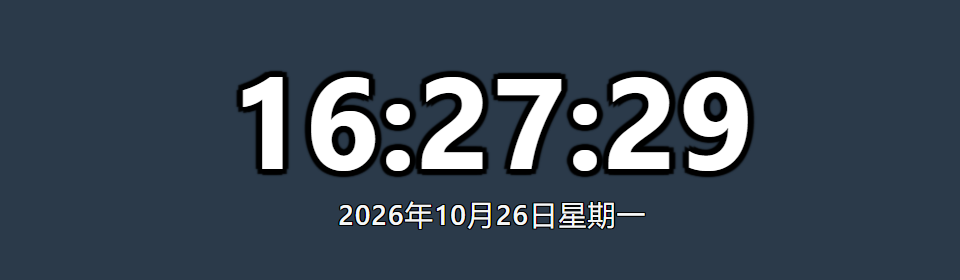
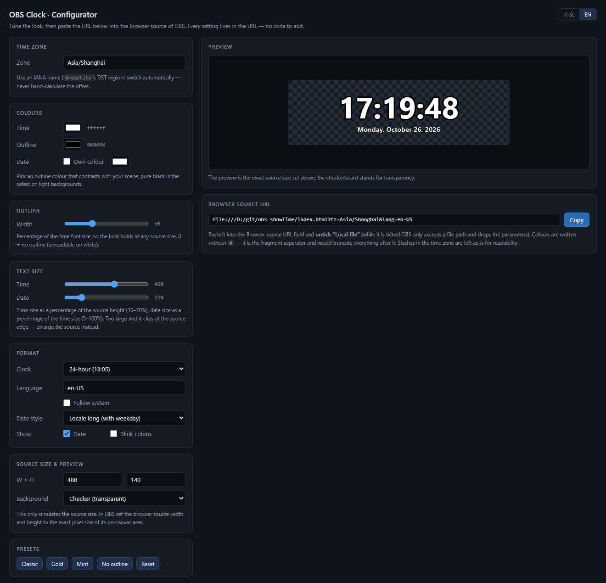
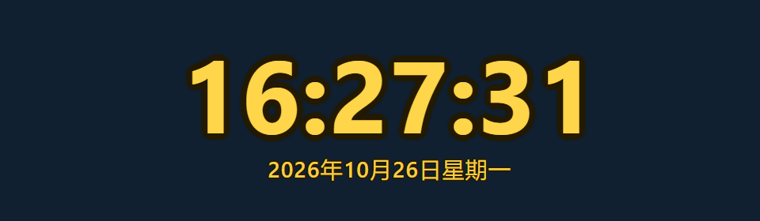

[中文README](README_ZH.md) · **English**

# OBS Browser Clock

> A minimal clock widget for OBS: big **HH:MM:SS** on top, the date in small type underneath.
> Single file, zero dependencies, works offline, transparent background — colours and time zone are set entirely through URL parameters.




---

## Features

- **Second-accurate** — ticks every second, aligned to real second boundaries, so it never drifts on long streams.
- **Date underneath** — small date line below the time; long / ISO / US / EU / weekday-only formats.
- **Fully styleable** — text colour, outline colour and width, independent colour for the date. All from the URL, no code changes.
- **Adjustable text size** — time and date sizes are separate, in percent of the source (so it scales with the source) or in absolute pixels.
- **Any time zone** — IANA names, including DST regions and half-hour zones such as +5:30 or +9:30.
- **Single file** — `index.html` inlines every bit of CSS and JS, requests nothing external, and runs straight from `file://`.
- **Transparent background** — overlays any scene without blocking the shot.
- **Configurator included** — `builder.html` gives a live preview and generates the link for you.

---

## Quick start

Two steps: **tune the look in the builder, then paste the generated link into OBS.** The builder only assembles the URL — what OBS actually loads is always `index.html`.

### Step 1 · Download

Download this repository, or just [`index.html`](index.html) plus [`builder.html`](builder.html), and **put both files in the same folder** — for example `D:/obs/clock/`.

> The builder derives the `index.html` path from its own location, so the two files must sit side by side.

### Step 2 · Tune the look

Open [`builder.html`](builder.html) (Chrome, Edge, or any modern browser — fully local, no network needed):

> The interface speaks both Chinese and English: it follows your system language (anything non-Chinese opens in English) and you can flip it at any time with the **中文 / EN** switch in the top-right corner. Switching it also retargets the clock's own `lang` parameter.

1. Pick the time zone, colours, outline width and date format on the left;
2. Watch the live preview on the right. Set **source size** to the exact pixel size you will use in OBS (default `480 × 140`), and the preview matches it 1:1;
3. When it looks right, hit **Copy** next to the URL field to grab the **OBS browser source URL**.



> Unsure about a parameter? Every field has a hint, and the defaults already give you a white clock with a black outline and a Chinese date.

### Step 3 · Paste into OBS

OBS → Sources → `+` → **Browser**:

1. **Untick "Local file"** — while it is ticked OBS only accepts a file path and silently drops the `?params`;
2. Paste the link from step 2 into the URL field, e.g. `file:///D:/obs/clock/index.html?tz=Asia/Tokyo&color=ffd54a&outline=241a00`;
3. Set width and height to **the same pixel size you used in step 2** (e.g. `480 × 140`). Don't scale the source with a transform — it blurs the text;
4. **Untick "Shutdown source when not visible"**, otherwise switching scenes reloads the page and flashes;
5. OK.

> Only want the default look with no parameters at all? Tick "Local file", pick `index.html`, and skip step 2.

To change something later: edit it in the builder, copy the new link, then right-click the source → **Refresh page**.

### Step 4 · Share it (optional)

Host `index.html` on GitHub Pages, Cloudflare Pages, or any static host — anyone can then paste the URL straight into a browser source. Bump a dummy parameter such as `&v=2` when you update it, to get around OBS's built-in browser cache.

---

## Parameters

Parameters go after the `?` in the URL, joined with `&`.

| Parameter | Meaning | Value | Default |
|---|---|---|---|
| `tz` | Time zone | IANA name, e.g. `Asia/Shanghai`, `America/New_York`, `Europe/London`; `local` = this machine | `Asia/Shanghai` |
| `offset` | Fixed offset (only when `tz` is absent) | Minutes: `480` = UTC+8, `-300` = UTC-5 | — |
| `color` | Time text colour | HEX, `#` optional | `ffffff` |
| `outline` | Outline colour | HEX, `#` optional | `000000` |
| `outlineWidth` | Outline thickness | Number = percent of the time font size; `px` suffix = absolute pixels | `5` |
| `size` | Time size | Number = percent of the source height (10–70); `px` suffix = absolute pixels | `46` |
| `dateSize` | Date size | Number = percent of the **time** font size (0–200); `px` suffix = absolute pixels | `22` |
| `dateColor` | Date colour | HEX, defaults to `color` | — |
| `h24` | 24-hour clock | `1` / `0` (`0` shows AM/PM after the seconds) | `1` |
| `lang` | Language / localisation | BCP-47, e.g. `en-US`, `ja-JP`, `de-DE`; `local` = system language | `zh-CN` |
| `dateFmt` | Date format | `iso` / `long` / `us` / `eu` / `weekday` | `long` |
| `blink` | Blink the colons every second | `1` / `0` | `0` |
| `showDate` | Show the date line | `1` / `0` | `1` |
| `debug` | Show parsed values and warnings in the top-left corner | `1` / `0` | `0` |
| `help` | Render this parameter table on screen | `1` / `0` | `0` |

### Date formats

| `dateFmt` | en-US | zh-CN |
|---|---|---|
| `long` | Monday, October 26, 2026 | 2026年10月26日星期一 |
| `iso` | 2026-10-26 | 2026-10-26 |
| `us` | 10/26/2026 | 10/26/2026 |
| `eu` | 26/10/2026 | 26/10/2026 |
| `weekday` | Monday | 星期一 |

### Examples

```text
# Default: Beijing, white text, black outline, 24-hour, Chinese long date
index.html

# Tokyo, gold text with a dark brown outline, blinking colons
index.html?tz=Asia/Tokyo&color=ffd54a&outline=241a00&blink=1

# New York, 12-hour clock, English date
index.html?tz=America/New_York&h24=0&lang=en-US

# India (UTC+5:30), ISO date
index.html?tz=Asia/Kolkata&dateFmt=iso

# Date language follows the system (English on an English machine, Chinese on a Chinese one)
index.html?lang=local

# Time only, no date
index.html?showDate=0

# Different colour for the date
index.html?color=ffffff&dateColor=9fd2ff
```



---

## Time zones

**Use IANA names (`Area/City`) and never hand-calculate an offset.** Regions with daylight saving time (US, Europe, Australia) shift twice a year, so a manual offset is wrong by an hour for part of the year. The rules ship with the browser and are applied automatically.

| Region | `tz` |
|---|---|
| Beijing / Shanghai | `Asia/Shanghai` |
| Hong Kong | `Asia/Hong_Kong` |
| Taipei | `Asia/Taipei` |
| Tokyo / Seoul | `Asia/Tokyo` / `Asia/Seoul` |
| Singapore | `Asia/Singapore` |
| New Delhi (+5:30) | `Asia/Kolkata` |
| Dubai | `Asia/Dubai` |
| London | `Europe/London` |
| Paris / Berlin | `Europe/Paris` / `Europe/Berlin` |
| Moscow | `Europe/Moscow` |
| New York / Chicago / Los Angeles | `America/New_York` / `America/Chicago` / `America/Los_Angeles` |
| São Paulo | `America/Sao_Paulo` |
| Sydney / Auckland | `Australia/Sydney` / `Pacific/Auckland` |
| Coordinated Universal Time | `UTC` |

The full list is in the [IANA Time Zone Database](https://www.iana.org/time-zones).

- `tz=local` follows the time zone of the machine running OBS.
- `offset` (in minutes) is only for cases with no matching city and no DST. For DST regions always use `tz`.
- A bad time zone never blanks the screen: it falls back to `Asia/Shanghai`. Add `debug=1` to see the warning.

---

## Colours, size and outline

### `#` cannot be used as-is

`#` is the fragment separator in a URL, so `?color=#fff` gets **truncated** and every parameter after it is lost. Pick any of these:

```text
index.html?color=fff          ← omit the #, recommended
index.html?color=%23fff       ← percent-encoded #
index.html?color=ff0000       ← six digits work too
```

Links generated by [`builder.html`](builder.html) are always safe — you never have to think about this.

### Text size

- `size` is a **percentage of the source height** (46% by default), so the same URL adapts to any source size. `dateSize` is a percentage of the **time** size (22% by default), so the date keeps its proportion when you change `size`.
- Both accept a `px` suffix for absolute pixels, e.g. `size=64px&dateSize=16px`.
- The time size also has a width cap (equivalent to `23.4vw`), so even `HH:MM:SS` never spills past the source width.

### Outline

You never control what is behind the overlay (a white slide deck, a bright web page, a well-lit room), so the outline is on by default:

- The outline is simulated with an 8-direction `text-shadow`, so unlike `-webkit-text-stroke` it never eats into the glyphs themselves.
- `outlineWidth` is a **percentage of the time font size** (5% by default), which keeps the look identical when you resize the source. Use an `px` suffix for absolute pixels, e.g. `outlineWidth=8px`.
- The date line scales with its own font size, so you never get a thick outline on the big digits and a thin one on the small date.
- Digits use `tabular-nums`, so the line doesn't jitter when the seconds tick over.

---

## OBS settings

| Setting | Recommended |
|---|---|
| Source size | **1:1** with the on-canvas size — never scale the source, or the text goes soft |
| Custom frame rate | **30** (keeps up with the ticking seconds; 15 works but looks laggy) |
| Shutdown source when not visible | **Off**, so switching scenes doesn't reload and flash |
| Background | The page is already transparent, nothing to do |
| Positioning | Use a transform on the source; make it full-canvas for a full-screen clock and it centres itself |

---

## License

[MIT](LICENSE)
