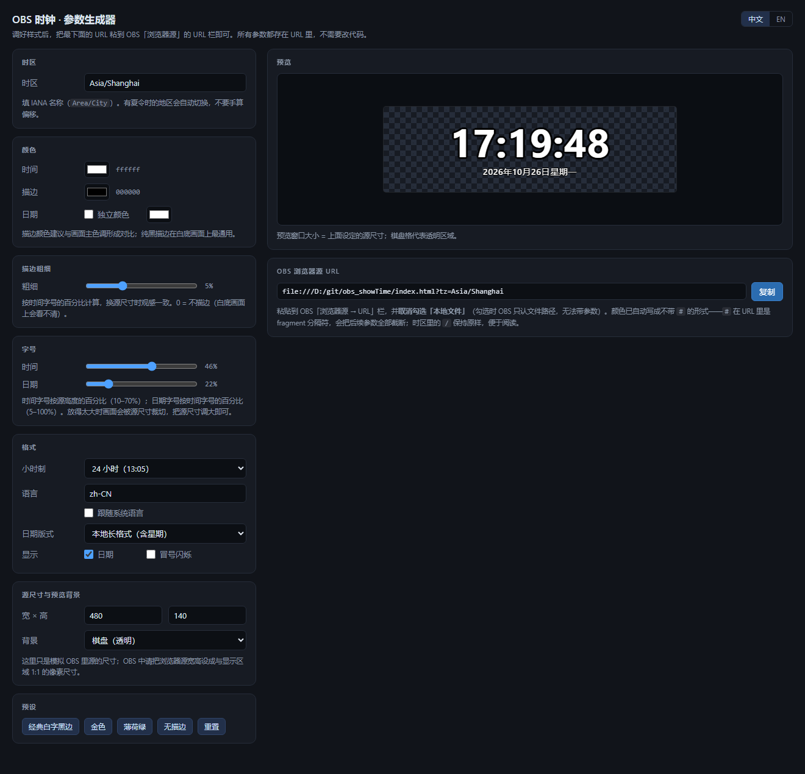

[English](README.md) · **简体中文**

# OBS 时钟 · OBS Browser Clock

> 给 OBS 用的极简时钟挂件：上方大字显示 **时:分:秒**，下方小字显示日期。
> 单文件、零依赖、可离线、背景透明，颜色和时区全部由 URL 参数控制。


---

## 特性

- **秒级时钟**：每秒刷新，且对齐真实整秒边界，长时间运行不累积漂移。
- **日期跟随**：时间下方小字显示日期，可选长格式 / ISO / 美式 / 欧式 / 仅星期。
- **样式全部可调**：文字颜色、描边颜色与粗细、日期独立配色，改 URL 即可，不用改代码。
- **字号可调**：时间与日期分别设置，可按源尺寸的百分比（随源缩放）或绝对像素。
- **任意时区**：IANA 时区名（含夏令时地区、`+5:30` 这类半时区）。
- **单文件交付**：`index.html` 内联全部 CSS/JS，不请求任何外部资源，`file://` 直接打开就能跑。
- **背景透明**：叠加在任意画面上都不会挡镜头。
- **附带生成器**：`builder.html` 提供可视化调参与实时预览，自动生成链接。

---

## 快速开始

流程只有两步：**先在生成器里调好样式并复制链接，再把它贴进 OBS。** 生成器只负责帮你拼 URL，真正被 OBS 加载的始终只有 `index.html`。

### 第 1 步 · 下载

下载本仓库，或同时下载 [`index.html`](index.html) 与 [`builder.html`](builder.html) 两个文件，**放在同一个文件夹**里，例如 `D:\obs\clock\`。

> 生成器会根据自己所在的位置推导 `index.html` 的路径，两个文件放一起才能生成正确链接。

### 第 2 步 · 用生成器调样式

双击打开 [`builder.html`](builder.html)（Chrome / Edge 均可，纯本地、不联网）：

> 界面支持中英双语：默认跟随系统语言（系统不是中文就用英文），也可以随时点右上角的 **中文 / EN** 切换；切换后时钟的日期语言会一起跟着变。

1. 左侧选时区、改颜色、调描边粗细、选日期版式；
2. 右侧实时预览。把「源尺寸」填成 **OBS 里实际要用的像素大小**（默认 `480 × 140`），预览框就按这个尺寸显示，所见即所得；
3. 满意后点 URL 框右侧的「复制」，拿到 **OBS 浏览器源 URL**。



> 不熟悉参数也没关系：每一项都有说明，全部留默认就是一个白色黑边的中文时钟。

### 第 3 步 · 粘贴进 OBS

OBS → 来源 → `+` → **浏览器**：

1. **取消勾选「本地文件」** —— 勾选状态下 OBS 只接受文件路径，URL 里的 `?参数` 会被丢掉；
2. 在 URL 栏粘贴第 2 步复制的链接，形如 `file:///D:/obs/clock/index.html?tz=Asia/Tokyo&color=ffd54a&outline=241a00`；
3. 宽高填**与第 2 步一致的像素尺寸**（如 `480 × 140`），不要靠缩放拉伸，否则字会发虚；
4. **取消勾选「场景不可见时关闭源」**，避免切场景时重新加载闪白；
5. 确定。

> 只想用默认样式、不需要任何参数？那就勾选「本地文件」直接选 `index.html`，跳过第 2 步即可。

之后想调整则回生成器进行改动，重新复制链接，在 OBS 源上右键 → **刷新页面**。

### 第 4 步 · 分享给别人（可选）

把 `index.html` 放到 GitHub Pages / Cloudflare Pages 等任意静态托管，别人直接把网址填进浏览器源就能用。更新后建议在链接末尾加 `&v=2` 之类的参数，绕开 OBS 内置浏览器的缓存。

---

## 参数说明

参数写在 URL 的 `?` 之后，多个参数用 `&` 连接。

| 参数 | 说明 | 取值 | 默认 |
|---|---|---|---|
| `tz` | 时区 | IANA 名称，如 `Asia/Shanghai`、`America/New_York`、`Europe/London`；`local` = 跟随本机 | `Asia/Shanghai` |
| `offset` | 固定偏移（`tz` 未指定时生效） | 分钟数，`480` = UTC+8，`-300` = UTC-5 | — |
| `color` | 时间文字颜色 | HEX，`#` 可省略 | `ffffff` |
| `outline` | 描边颜色 | HEX，`#` 可省略 | `000000` |
| `outlineWidth` | 描边粗细 | 数字 = 时间字号的百分比；加 `px` 后缀 = 绝对像素 | `5` |
| `size` | 时间字号 | 数字 = 源高度的百分比（10–70）；加 `px` 后缀 = 绝对像素 | `46` |
| `dateSize` | 日期字号 | 数字 = **时间**字号的百分比（0–200）；加 `px` 后缀 = 绝对像素 | `22` |
| `dateColor` | 日期颜色 | HEX，默认与 `color` 相同 | — |
| `h24` | 24 小时制 | `1` / `0`（`0` 时在秒后显示 AM/PM） | `1` |
| `lang` | 语言与本地化 | BCP-47，如 `en-US`、`ja-JP`、`de-DE`；`local` = 跟随系统语言 | `zh-CN` |
| `dateFmt` | 日期版式 | `iso` / `long` / `us` / `eu` / `weekday` | `long` |
| `blink` | 冒号每秒闪烁 | `1` / `0` | `0` |
| `showDate` | 是否显示日期 | `1` / `0` | `1` |
| `debug` | 左上角显示解析结果与告警，排查用 | `1` / `0` | `0` |
| `help` | 画面内显示这张参数表 | `1` / `0` | `0` |

### 日期版式

| `dateFmt` | zh-CN | en-US |
|---|---|---|
| `long` | 2026年10月26日星期一 | Monday, October 26, 2026 |
| `iso` | 2026-10-26 | 2026-10-26 |
| `us` | 10/26/2026 | 10/26/2026 |
| `eu` | 26/10/2026 | 26/10/2026 |
| `weekday` | 星期一 | Monday |

### 示例

```text
# 默认：北京、白字黑边、24 小时、中文长日期
index.html

# 东京，金色字 + 深棕描边，冒号闪烁
index.html?tz=Asia/Tokyo&color=ffd54a&outline=241a00&blink=1

# 纽约，12 小时制 + 英文
index.html?tz=America/New_York&h24=0&lang=en-US

# 印度（UTC+5:30），ISO 日期
index.html?tz=Asia/Kolkata&dateFmt=iso

# 日期语言跟随系统（英文系统显示英文，中文系统显示中文）
index.html?lang=local

# 只显示时间，不要日期
index.html?showDate=0

# 日期用另一种颜色
index.html?color=ffffff&dateColor=9fd2ff
```


---

## 时区

**请使用 IANA 名称（`Area/City`），不要自己算偏移。** 有夏令时的地区（美、欧、澳）一年要跳两次，手算必然错一小时；时区规则由浏览器内置，会自动处理。

| 地区 | `tz` |
|---|---|
| 北京 / 上海 | `Asia/Shanghai` |
| 香港 | `Asia/Hong_Kong` |
| 台北 | `Asia/Taipei` |
| 东京 / 首尔 | `Asia/Tokyo` / `Asia/Seoul` |
| 新加坡 | `Asia/Singapore` |
| 新德里（+5:30） | `Asia/Kolkata` |
| 迪拜 | `Asia/Dubai` |
| 伦敦 | `Europe/London` |
| 巴黎 / 柏林 | `Europe/Paris` / `Europe/Berlin` |
| 莫斯科 | `Europe/Moscow` |
| 纽约 / 芝加哥 / 洛杉矶 | `America/New_York` / `America/Chicago` / `America/Los_Angeles` |
| 圣保罗 | `America/Sao_Paulo` |
| 悉尼 / 奥克兰 | `Australia/Sydney` / `Pacific/Auckland` |
| 协调世界时 | `UTC` |

完整列表见 [IANA Time Zone Database](https://www.iana.org/time-zones)。

- `tz=local` 跟随运行 OBS 的这台机器的系统时区。
- `offset` 只适合「没有对应城市、固定不随夏令时变化」的场景，单位是分钟。有 DST 的地区请务必用 `tz`。
- 时区写错不会白屏：会自动回退到 `Asia/Shanghai`，加 `debug=1` 能看到回退提示。

---

## 颜色、字号与描边

### `#` 不能直接写

URL 里的 `#` 是 fragment 分隔符，`?color=#fff` 会被**截断**，后面的参数全部丢失。三种写法任选：

```text
index.html?color=fff          ← 省略 #，推荐
index.html?color=%23fff       ← 编码后的 #
index.html?color=ff0000       ← 六位同理
```

用 [`builder.html`](builder.html) 生成链接时不用操心这件事，它输出的链接是安全的。

### 字号

- `size` 是**源高度的百分比**（默认 46%），同一个链接换到别的源尺寸也合适；`dateSize` 是**时间**字号的百分比（默认 22%），改 `size` 时日期自动保持比例。
- 两者都能加 `px` 后缀改用绝对像素，例如 `size=64px&dateSize=16px`。
- 时间字号另有宽度上限（等效 `23.4vw`），八位时分秒也不会顶出源宽度。

### 描边

直播画面背景不可控（白色 PPT、浅色网页、明亮实景都可能出现），所以描边默认开启：

- 用 8 方向 `text-shadow` 模拟外描边，不会像 `-webkit-text-stroke` 那样吃掉字形内侧。
- `outlineWidth` 默认按**时间字号的百分比**计算（默认 5%），换源尺寸时观感保持一致；需要绝对像素时写 `outlineWidth=8px`。
- 日期小字按自身字号等比缩放，不会出现「大字描边太粗、小字太细」的割裂感。
- 数字使用等宽数字（`tabular-nums`），秒数跳动时整行不会左右抖。

---

## OBS 设置建议

| 项 | 建议 |
|---|---|
| 源宽高 | 与画布上的显示尺寸 **1:1**，不要靠缩放，否则字发虚 |
| 自定义帧率 | **30**（秒数变化最快跟手；15 也够，但秒会显得迟滞） |
| 场景不可见时关闭源 | **不勾**，避免切场景重新加载 |
| 背景 | 页面本身透明，无需额外处理 |
| 定位 | 用源的变换摆位；需要整屏时可把源设为全画布，时钟自动居中 |

---

## License

[MIT](LICENSE)
